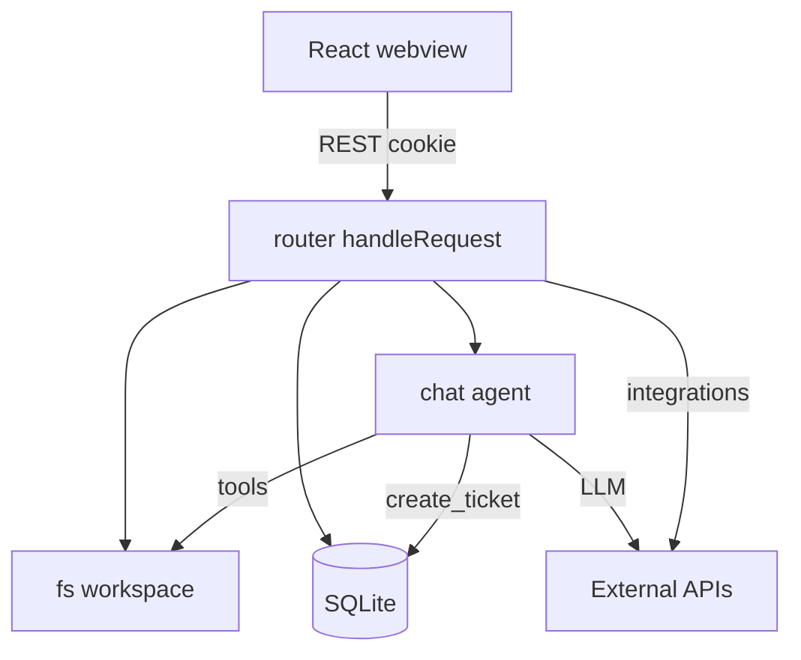

# Architecture

## Entry & bootstrap

1. `main.ts` — `bootstrap()` → `createMainWindow()` → `Deno.serve(..., handleRequest)`
2. `src/core/bootstrap.ts` — pastikan app data dir, buka DB, prune events
3. `src/desktop/window.ts` — `Deno.BrowserWindow` (null jika bukan runtime desktop)
4. `src/server/router.ts` — satu `handleRequest` untuk static + REST + SSE + upgrade terminal

## Modul backend (`src/`)

| Modul | Path | Tanggung jawab |
| --- | --- | --- |
| Core | `src/core/` | paths, logger, bootstrap, HTML sanitize |
| Config | `src/config/schema.ts` | Zod: semua input API & config integrasi |
| DB | `src/db/db.ts` | SQLite (`node:sqlite`), migrasi `ensureColumn` |
| FS | `src/fs/workspace.ts`, `documents.ts` | File workspace (guarded) + dokumen lokal `.md` |
| Integrations | `src/integrations/` | Docmost, Notion, Confluence, Jira, GitHub, Git CLI, HTTP helper |
| Server | `src/server/` | router, session, static, SSE, chat, terminal, skills, MCP, routes |
| Tickets | `src/tickets/status.ts` | Normalisasi kolom Kanban / automation |
| Desktop | `src/desktop/` | window, bindings, native dialogs |
| UI assets | `src/ui/assets.generated.ts` | Bundle client (generated) |

## Modul chat (`src/server/chat/`)

| File | Peran |
| --- | --- |
| `agent.ts` | `startChat`, system prompt, tool loop |
| `tools.ts` | Definisi & eksekusi tools per mode |
| `review.ts` | Pending write + keputusan hunk |
| `llm.ts` | HTTP ke provider, temperature variant |
| `tickets.ts` | Generate tiket dari dokumen |
| `skill-learn.ts` | Tulis skill project setelah Build sukses |
| `state.ts` | Run in-memory |
| `diff.ts` (sibling) | Line/hunk diff |

## Frontend (`web/`)

- React 19 + Vite + Tailwind v4 + shadcn (`components/ui`) + ReUI Kanban
- Shell: `web/src/App.tsx`
- API client: `web/src/lib/api.ts`
- Events: `review-events.ts`, `auto-build-events.ts`
- Alias `@/` → `web/src/`

Build: `npm --prefix web run build` → `scripts/build-assets.ts` embed ke generated TS. Runtime
**tidak** membaca file UI dari disk.

## Keamanan lokal API

- Server bind `127.0.0.1` (port via `DENO_SERVE_ADDRESS` bila diset)
- Token sesi acak (`src/server/session.ts`); cookie `app_token` (HttpOnly, SameSite=Strict) saat HTML dilayani
- Semua `/api/*` kecuali `GET /api/health` butuh cookie atau header `x-app-token`
- Path workspace: wajib lewat `src/fs/workspace.ts` (tolak `..`, symlink escape, batas ukuran baca)
- Secret di-mask saat serialisasi ke renderer (`SECRET_CONFIG_KEYS`)

## Global vs per-project

| Global | Per project |
| --- | --- |
| LLM providers | Workspace / document path |
| Roles | Integrasi Docmost/Notion/Confluence/Jira/GitHub |
| MCP servers | Chat sessions & messages |
| Skills enable/disable | Local tickets & local document sync meta |
| Automation | Git/terminal cwd = `workspace_path` |

## Diagram ringkas

